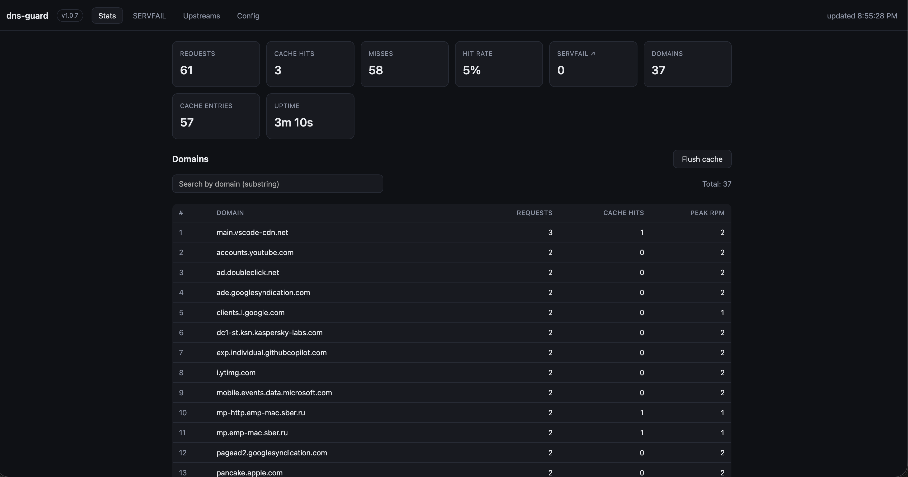

# dns-guard

Небольшой DNS-сервис для MikroTik RouterOS (ARM64-контейнер). Принимает запросы
по **UDP/53** и **TCP/53**, маршрутизирует их по правилам зон на группы
вышестоящих серверов (**UDP / DoT / DoH**) с primary+fallback, применяет
MIN/MAX-TTL, кэширует ответы в памяти и показывает статистику (полные доменные
имена с пиковым RPM, нагрузка по группам и апстримам, поиск и пагинация) в
веб-интерфейсе.

## Возможности

- Приём DNS по UDP и TCP на порту 53.
- Маршрутизация по зонам (longest-suffix match): `ru`, `*.ru`, `example.com`.
- Группы апстримов с протоколом на группу: `udp` / `dot` / `doh`.
- Primary + fallback: резервные серверы используются при ошибке запроса к
  основным, а также когда основной ответил NODATA (NOERROR без записей) на
  **A/AAAA** — такой ответ проверяется резервными, и первый положительный ответ
  выигрывает. Для остальных типов (HTTPS/SVCB и т.п.) NODATA штатен и резерв не
  привлекается. Фоновых health-check нет; основные — с ротацией.
- Bootstrap-резолв хостнеймов DoH/DoT через заданный plain-DNS либо
  статический маппинг `hosts` (хостнейм→IP).
- In-memory LRU-кэш с границами TTL (MIN-TTL пол, MAX-TTL потолок),
  кэширование негативных ответов (по SOA minttl) с отдельным потолком
  `neg_ttl`. Сброс при рестарте.
- Дедупликация одинаковых одновременных запросов (singleflight): параллельные
  промахи обслуживаются одним обращением к апстриму.
- Автоматический повтор усечённого (TC) UDP-ответа апстрима по TCP.
- EDNS Client Subnet (RFC 7871): передача вышестоящим серверам нашей публичной
  подсети, чтобы гео-зависимые CDN возвращали адреса, близкие к нам, а не к
  локации удалённого резолвера. Публичная подсеть задаётся в конфиге; для групп,
  которые должны резолвиться «оттуда» (VPN), ECS можно отключить отдельно.
- Блокировка доменов и всех их поддоменов (longest-suffix): заблокированный
  домен не уходит к апстриму, а получает пустой ответ (`nodata`) или фиктивный
  адрес `0.0.0.0` / `::` (`zero`). Список хранится в `config.yaml`, правится
  кнопкой у домена на вкладке Stats и применяется на лету со сбросом кэша.
- Горячая перезагрузка конфигурации (SIGHUP или через веб-UI), без простоя.
- Веб-UI (на английском) и REST API: статистика по полным доменам с пиковым
  RPM, поиск, пагинация и сводные сведения по домену — успешные записи,
  склеенные по всем типам запросов (A, AAAA, HTTPS, ...), и последние
  негативные ответы (NODATA/NXDOMAIN) с цепочкой опрошенных апстримов,
  отдельная вкладка Upstreams с нагрузкой по группам и серверам (успешные и
  неудачные попытки), правка конфига.
- Один статический бинарь, без CGO, работает в distroless.

## Запуск готового образа

Готовый образ публикуется в Docker Hub:
[`nskforward/dns-guard`](https://hub.docker.com/r/nskforward/dns-guard).
Тег `latest` — последняя версия; для воспроизводимого деплоя используйте
конкретный тег (`nskforward/dns-guard:1.0.7`).

```sh
cp config.example.yaml config.yaml

docker pull nskforward/dns-guard:latest

docker run -d --name dns-guard \
  --restart unless-stopped \
  -p 53:53/udp -p 53:53/tcp \
  -p 8080:8080 \
  -v "$PWD/config.yaml:/etc/dns-guard/config.yaml" \
  nskforward/dns-guard:latest
```

Конфиг монтируется в `/etc/dns-guard/config.yaml` — этот путь контейнер
использует по умолчанию. Монтируйте его **для записи** (без `:ro`), иначе
кнопка **Save** в веб-интерфейсе не сможет сохранить изменения. Дополнительные
флаги передаются после имени образа:

```sh
docker run ... nskforward/dns-guard:latest -log-level debug
```

| Флаг | По умолчанию | Описание |
|---|---|---|
| `-config` | `/etc/dns-guard/config.yaml` (в контейнере) | путь к файлу конфигурации |
| `-log-level` | `info` | `debug` / `info` / `warn` / `error` |

Проверка:

```sh
dig @127.0.0.1 example.com A     # UDP
dig @127.0.0.1 example.com A +tcp # TCP
curl -s localhost:8080/api/health
```

## Веб-интерфейс

Веб-UI доступен по адресу `http://<ip-контейнера>:8080`: статистика запросов и
кэша, домены с поиском и пиковым RPM, вкладки Upstreams и SERVFAIL, а также
редактирование конфигурации с применением на лету. На вкладке Stats у каждого
домена есть иконка блокировки: клик блокирует домен и его поддомены (повторный
клик снимает блокировку), заблокированные строки подсвечиваются красным, а
фильтр **Blocked only** (и карточка **Blocked**) показывает только их.

[](assets/web-ui-example.png)

## Конфигурация

> **Конфигурацию можно менять прямо в веб-интерфейсе контейнера.** Откройте
> `http://<ip-контейнера>:8080`, вкладка **Config**, отредактируйте YAML и
> нажмите **Save**. Конфиг валидируется, применяется на лету (**live reload**,
> без перезапуска контейнера) и сохраняется в смонтированный `config.yaml`.
> Ошибочная конфигурация не применяется — UI покажет текст ошибки. То же самое
> доступно через `PUT /api/config`; при ручной правке файла на диске
> перезагрузку можно инициировать сигналом `SIGHUP`.

См. `config.example.yaml`. Ключевые секции:

```yaml
listen:
  udp: ":53"
  tcp: ":53"
web:
  enabled: true
  listen: ":8080"
cache:
  enabled: true
  max_entries: 10000
  min_ttl: 60      # пол TTL (секунды)
  max_ttl: 0       # 0 = без верхней границы
  neg_ttl: 300     # потолок TTL негативных ответов, 0 = без потолка
stats:
  max_domains: 50000  # лимит уникальных доменов в таблице статистики
upstream:
  timeout: 3s      # таймаут одной попытки; общий бюджет = timeout × число попыток
ecs:
  enabled: true
  subnet: "203.0.113.0/24"       # наш публичный IPv4-префикс (обрезается до /24)
  ipv6_subnet: "2001:db8::/56"   # опционально (обрезается до /56)
block:
  mode: nodata               # nodata = пустой NOERROR | zero = 0.0.0.0 / ::
  domains:
    - ads.example.com        # поддомены блокируются автоматически
groups:
  a:
    protocol: udp            # udp | dot | doh
    primary:  ["77.88.8.8", "8.8.8.8"]
    fallback: ["1.1.1.1"]
  b:
    protocol: udp            # UDP primary + DoH fallback через префикс
    primary:  ["192.168.1.1:53"]
    fallback: ["doh+https://9.9.9.9/dns-query"]
  c:
    protocol: doh
    primary:  ["https://doh.example.com:8443/secret/dns-query"]
    fallback: ["https://9.9.9.9/dns-query"]
    hosts: {"doh.example.com": "203.0.113.10"} # статический хостнейм→IP
  vpn:
    protocol: doh
    primary:  ["https://dns.example.com/dns-query"]
    ecs: false               # не передавать нашу подсеть — ответы «оттуда»
default_group: a
rules:
  - zone: "ru"
    group: b
  - zone: "vpn-only.example"
    group: vpn
```

- `zone` нормализуется: `ru`, `*.ru`, `.ru` и `RU.` эквивалентны.
- Для `dot`/`doh` указывайте хостнейм (`dns.google`) или URL
  (`https://dns.google/dns-query`). Порт по умолчанию: 53 (udp), 853 (dot).
- Любой адрес апстрима может нести префикс `<udp|dot|doh>+`, который
  перекрывает протокол группы. Это позволяет смешивать протоколы внутри одной
  группы — например, UDP primary и DoH fallback:
  ```yaml
  b:
    protocol: udp
    primary:  ["192.168.1.1:53"]
    fallback: ["doh+https://9.9.9.9/dns-query"]
  ```
  Префиксом считается только ведущий токен без `/`, `:`, `?`, поэтому знак `+`
  внутри URL (`...?a=1+2`) префиксом не воспринимается. Неизвестный префикс
  (`tcp+…`) — ошибка валидации.
- `bootstrap` — plain-DNS для резолва хостнеймов апстримов. `hosts` —
  статический маппинг хостнейм→IP (приоритетнее bootstrap): полезен, когда
  plain-DNS до резолвера недоступен. Хостнейм остаётся в URL для TLS-SNI и
  проверки сертификата, а соединение идёт на указанный IP. `hosts` действует на
  всю группу, включая fallback другого протокола.
- `cache.neg_ttl` — потолок TTL негативных ответов (NXDOMAIN и NODATA по SOA):
  ошибочный негативный ответ апстрима не «консервируется» в кэше дольше
  указанного времени. `0` — не ограничивать (действуют только `max_ttl` и
  SOA minttl).
- `upstream.timeout` — таймаут **одной** попытки. Общий бюджет запроса —
  `timeout` × число серверов в выбранной группе (primary+fallback), поэтому
  fallback успевает сработать даже при «висящем» primary, а не только при
  быстром отказе.
- `ecs` — EDNS Client Subnet (RFC 7871). В запросы к апстриму добавляется наша
  публичная подсеть; CDN и гео-балансировщики возвращают адреса, близкие к нам,
  а не к локации резолвера. Слишком конкретный префикс обрезается до `/24`
  (IPv4) и `/56` (IPv6). Подсеть задаётся статически: она меняется редко, а
  лишний сетевой запрос и фоновая горутина не нужны. При смене подсети в
  конфиге кэш сбрасывается автоматически.
- `groups.<name>.ecs: false` — не передавать ECS для этой группы. Нужно для
  зон, которые специально должны резолвиться с локацией удалённого апстрима
  (например, чтобы адреса попадали в VPN-маршрутизацию).
- `block.domains` — домены, которые блокируются вместе со всеми поддоменами
  (совпадение по границе метки: `ads.example.com` блокирует
  `x.ads.example.com`, но не `notads.example.com`). Запросы к ним не уходят к
  апстриму и не попадают в кэш. При изменении списка кэш сбрасывается
  автоматически, чтобы ответы, полученные до блокировки, не обходили её.
- `block.mode` — форма ответа: `nodata` (по умолчанию) — пустой `NOERROR` без
  записей; `zero` — `A` → `0.0.0.0`, `AAAA` → `::`, остальные типы — пустой
  `NOERROR`. Оба варианта не позволяют установить соединение.
- Конфигурация применяется целиком: при изменении крайне рекомендуется
  оставить `default_group` существующим.

## EDNS Client Subnet: гео-ответы с удалённого upstream

Если вышестоящий сервер находится в другой локации, CDN выбирает edge-узлы по
**IP резолвера**, а не клиента: браузер получает адреса чужого региона и иногда
вообще не может подключиться. ECS (RFC 7871) решает это: dns-guard добавляет в
исходящий запрос опцию с нашей публичной подсетью, резолвер передаёт её
авторитативным серверам, и те отвечают адресами, геолоцированными к нам.

```yaml
ecs:
  enabled: true
  subnet: "203.0.113.0/24"
groups:
  vpn:
    protocol: doh
    primary: ["https://dns.example.com/dns-query"]
    ecs: false   # этой группе ECS не передаём
```

Особенности:

- Подсеть задаётся вручную в `ecs.subnet` (`ipv6_subnet` — опционально). Она
  меняется редко, поэтому автодетект не нужен: достаточно обновить конфиг при
  смене адреса провайдером.
- Схема «роутер → контейнер» означает, что dns-guard видит клиентов только как
  частные адреса (`192.168.x.x`), поэтому публичную подсеть нельзя вычислить из
  запроса — её нужно задать. Одной подсети хватает на всю домашнюю сеть.
- Слишком конкретный префикс обрезается до `/24` (IPv4) и `/56` (IPv6): этого
  достаточно для геолокации, и это меньше раскрывает приватность. Указывайте
  реальный публичный префикс: некоторые резолверы отвергают ECS со служебных
  диапазонов (TEST-NET, private) — например, Google отвечает на них REFUSED.
- ECS работает поверх UDP, DoT и DoH — опция находится в DNS-сообщении.
- Для групп, которые должны резолвиться «оттуда» (VPN), укажите `ecs: false`,
  иначе CDN вернёт локальные адреса и маршрутизация в VPN не сработает.
- Если удалённый upstream — ваш собственный recursor (unbound/knot-resolver),
  включите на нём проброс ECS к авторитативным серверам, иначе он проигнорирует
  опцию: для unbound — сборка с `--enable-subnet`, `module-config:
  "subnetcache validator iterator"`, `client-subnet-always-forward: yes`; для
  Knot Resolver — модуль `subnet`. Готовый пример — в разделе
  «Собственный upstream на VPS: nginx + unbound».
- ECS поддерживают не все публичные резолверы: Google (`8.8.8.8`, `dns.google`),
  OpenDNS, Quad9 в варианте `9.9.9.11` — да; Cloudflare `1.1.1.1` — нет. Если
  ECS-совместимого upstream нет, используйте маршрутизацию зон на ближайший
  резолвер через `rules`.
- Ответы, полученные с прежней подсетью, при её смене сбрасываются из кэша
  автоматически.

Проверка, что ECS доходит до авторитативных серверов:

```sh
# Google эхом возвращает увиденную подсеть в TXT-ответе:
dig @127.0.0.1 o-o.myaddr.l.google.com TXT
```

## Собственный upstream на VPS: nginx + unbound

Публичные резолверы по-разному относятся к ECS: Cloudflare `1.1.1.1` опцию
игнорирует, Google поддерживает, но применяет свои правила. Собственный
recursor на VPS даёт полный контроль над ECS и кэшем. Рабочая схема:

```
dns-guard --DoH/TLS--> nginx :8443 --> doh-proxy :8053 --> unbound :53 --> авторитативные серверы
```

- nginx терминирует TLS и прячет endpoint за секретным путём;
- doh-proxy (`doh-server`) превращает DoH в обычный DNS для unbound;
- unbound рекурсивно резолвит и пробрасывает ECS авторитативным серверам.

Пример для Ubuntu 24.04 / Debian 12.

### 1. Пакеты

```sh
apt install -y unbound nginx
unbound -V | grep -o subnetcache   # ECS-модуль должен быть в сборке
```

Пакеты Debian/Ubuntu собраны с `--enable-subnet`, поэтому `subnetcache` есть.

### 2. unbound

`/etc/unbound/unbound.conf.d/dns-guard.conf`:

```yaml
server:
    # Слушаем только localhost: снаружи доступ лишь через nginx + doh-proxy.
    interface: 127.0.0.1
    access-control: 127.0.0.0/8 allow
    access-control: 0.0.0.0/0 refuse

    do-ip4: yes
    do-ip6: no
    do-udp: yes
    do-tcp: yes

    qname-minimisation: yes
    prefetch: yes
    harden-glue: yes
    harden-dnssec-stripped: yes
    hide-identity: yes
    hide-version: yes
    do-not-query-localhost: yes

    msg-cache-size: 32m
    rrset-cache-size: 64m

    # ECS (RFC 7871): принимаем подсеть от dns-guard и передаём её
    # авторитативным серверам, кэшируя ответы по подсетям.
    module-config: "subnetcache validator iterator"
    client-subnet-always-forward: yes
    max-client-subnet-ipv4: 24
    max-client-subnet-ipv6: 56
```

```sh
unbound-checkconf
systemctl restart unbound
```

- `module-config` с `subnetcache` обязателен: без модуля unbound молча
  отбрасывает входящую ECS-опцию. В сборках с ECS он стоит по умолчанию, но
  явная строка защищает от смены дефолта.
- `client-subnet-always-forward: yes` — ключевой параметр: без него unbound
  пересылает ECS только авторитативным адресам из `send-client-subnet`, то есть
  по умолчанию никому. С `yes` присланная dns-guard подсеть уходит любым
  авторитативным серверам.
- Ответы с ECS кэшируются отдельно по подсетям (обычный кэш для них
  пропускается) — это ожидаемо и обеспечивает корректную геолокацию.
- `max-client-subnet-ipv4/ipv6` ограничивают длину префикса; dns-guard и так
  нормализует её до `/24` и `/56`.
- DNSSEC-якорь (`auto-trust-anchor-file`) в Debian/Ubuntu уже настроен пакетом
  отдельным файлом в `unbound.conf.d/`, добавлять его в этот конфиг не нужно.
- `prefetch` не работает для записей subnet-кэша: unbound пишет об этом
  warning при старте — это ожидаемо.

### 3. doh-proxy

Готовый бинарь `doh-server` (Rust) берём из релизов
<https://github.com/jedisct1/doh-server/releases> (linux-amd64/arm64):

```sh
install -m 0755 doh-server /usr/bin/doh-proxy
```

`/etc/systemd/system/doh-proxy.service`:

```ini
[Unit]
Description=DoH proxy (doh-server) in front of unbound
After=network.target unbound.service
Wants=unbound.service

[Service]
ExecStart=/usr/bin/doh-proxy -H dns.example.com -u 127.0.0.1:53 -l 127.0.0.1:8053
Restart=on-failure
RestartSec=2s
DynamicUser=yes
NoNewPrivileges=yes
ProtectSystem=strict
ProtectHome=yes
PrivateTmp=yes
PrivateDevices=yes
CapabilityBoundingSet=
AmbientCapabilities=
RestrictAddressFamilies=AF_INET AF_INET6

[Install]
WantedBy=multi-user.target
```

```sh
systemctl daemon-reload
systemctl enable --now doh-proxy
```

`-H` — ожидаемый `Host` (защита от обращения по чужому имени), `-u` — адрес
unbound, `-l` — локальный HTTP-порт для nginx. Порт 8053 наружу не публикуем.

### 4. nginx

Сертификат — обычный Let's Encrypt (HTTP-01 требует открытый `:80`):

```sh
certbot certonly --nginx -d dns.example.com
```

`/etc/nginx/sites-enabled/dns-guard`:

```nginx
limit_req_zone $binary_remote_addr zone=doh:10m rate=100r/s;

server {
    listen 8443 ssl http2;
    listen [::]:8443 ssl http2;
    server_name dns.example.com;

    ssl_certificate     /etc/letsencrypt/live/dns.example.com/fullchain.pem;
    ssl_certificate_key /etc/letsencrypt/live/dns.example.com/privkey.pem;
    ssl_protocols TLSv1.2 TLSv1.3;

    # Секретный путь: endpoint не находится перебором.
    location = /<секрет>/dns-query {
        limit_req zone=doh burst=200 nodelay;

        proxy_pass http://127.0.0.1:8053/dns-query;
        proxy_http_version 1.1;
        proxy_set_header Connection "";
        proxy_set_header Host $host;
        proxy_set_header X-Real-IP $remote_addr;
    }

    location / { return 404; }
}
```

```sh
nginx -t && systemctl reload nginx
```

### 5. Группа в dns-guard

```yaml
ecs:
  enabled: true
  subnet: "203.0.113.0/24"

groups:
  vps:
    protocol: doh
    primary:
      - https://dns.example.com:8443/<секрет>/dns-query
    fallback:
      - https://9.9.9.9/dns-query
    # hosts: {"dns.example.com": "203.0.113.10"}  # если DNS до VPS недоступен

default_group: vps
```

nginx и doh-proxy не разбирают DNS-сообщение, поэтому ECS-опция, добавленная
dns-guard, доходит до unbound, а он передаёт её дальше. Сертификат проверяется
по хостнейму из URL, поэтому `hosts` (если нужен) задаёт только IP.

### 6. Проверка

На VPS, напрямую в unbound (Akamai возвращает увиденную подсеть в TXT):

```sh
dig @127.0.0.1 whoami.ds.akahelp.net TXT +short +subnet=203.0.113.0/24
# "ecs" "203.0.113.0/24/24"
```

Через всю цепочку и dns-guard (подсеть берётся из `ecs.subnet`):

```sh
dig @192.168.88.1 whoami.ds.akahelp.net TXT +short
# "ecs" "203.0.113.0/24/24"
```

Если строки `"ecs"` нет — unbound не пробрасывает опцию: проверьте
`client-subnet-always-forward: yes` и `unbound-checkconf -o module-config`.

При проверке через роутер MikroTik не забудьте `/ip/dns/cache/flush`:
RouterOS кэширует ответы без учёта ECS и иначе отдаст старый ответ, полученный
до включения подсети.

### 7. Эксплуатация

- Наружу открыты только `8443` (DoH) и `80` (ACME); unbound и doh-proxy слушают
  localhost.
- Секретный путь в URL + TLS — минимальная защита от случайного использования
  резолвера. Дополнительно можно ограничить доступ в nginx через `allow`.
- При продлении сертификата перезагружайте nginx (`deploy-hook` у certbot).
- Не публикуйте unbound в интернет: открытый рекурсивный резолвер быстро
  становится участником DNS-амплификации.

## REST API

| Метод | Путь | Описание |
|---|---|---|
| GET | `/api/health` | `{"status":"ok"}` |
| GET | `/api/version` | `{"version":"1.0.4"}` — версия сборки (в UI отображается в шапке) |
| GET | `/api/stats` | общие счётчики, uptime, размер кэша, распределение по группам |
| GET | `/api/domains` | страница доменов: `?page=1&limit=50&search=подстрока&blocked=1` (только заблокированные) |
| GET | `/api/domain` | статистика домена и сводные сведения: успешные записи по домену (склейка ответов по qtype) и последние негативные ответы NODATA/NXDOMAIN по типам с цепочкой апстримов: `?name=example.com` |
| GET | `/api/upstreams` | статистика по группам и апстримам: запросы, кэш-хиты, успешные и неудачные попытки |
| GET | `/api/servfail` | детали SERVFAIL: домены с числом ошибок и последней ошибкой (`?page=1&limit=50`), журнал последних 100 событий |
| PUT | `/api/block?name=example.com` | заблокировать домен и поддомены; применяется и сохраняется в конфиг |
| DELETE | `/api/block?name=example.com` | снять блокировку |
| GET | `/api/config` | `{"yaml":"..."}` текущая эффективная конфигурация |
| PUT | `/api/config` | тело — YAML; валидируется, применяется на лету и сохраняется в файл |
| POST | `/api/cache/flush` | очистить кэш |

Веб-интерфейс показывает полные доменные имена (без сокращения до домена
второго уровня), позволяет искать по подстроке без учёта регистра,
переключать страницы (50 записей на страницу) и по клику на домен
просматривать сводные сведения о нём: все известные записи (Answer и
Authority), склеенные из последних успешных ответов по всем типам запросов
(A, AAAA, HTTPS, ...), с TTL, а также атрибуты самого свежего ответа —
`Status` (OK), источник, апстрим (включая ответы из кэша — сохраняется сервер,
выдавший исходный ответ) и время. Негативные ответы показываются отдельными
карточками по типам запросов: `Status` NODATA или NXDOMAIN, тип, источник,
итоговый апстрим, время и цепочка «Upstreams tried» — какие серверы
опрашивались и с каким результатом (для A/AAAA NODATA основной ответ
проверяется резервными, поэтому в цепочке видно все попытки). Негативные
ответы не затирают ранее полученные записи, а свежий успешный ответ снимает
негативный того же типа; ошибки SERVFAIL — на отдельной вкладке. Цепочка
«Upstreams tried» показывается и у успешных ответов, полученных после NODATA
основного сервера. Вкладка Upstreams показывает для каждой группы число
запросов, кэш-хитов, успешных ответов и ошибок, а по
клику на группу — разбивку по конкретным серверам с их долей нагрузки.
Счётчик SERVFAIL на вкладке Stats кликабелен и открывает вкладку SERVFAIL:
домены с числом ошибок, долей от общего числа SERVFAIL и последней ошибкой
(по клику на домен — его сводные сведения), а также журнал последних 100
событий с временем, типом, группой, апстримом, источником (кэш/апстрим) и
текстом ошибки.

На вкладке Stats заблокированные домены подсвечены мягким красным, а у каждого
домена есть иконка block/unblock. Фильтр **Blocked only** и кликабельная
карточка **Blocked** оставляют в таблице только заблокированные домены. В
сводке домена блокировка показывается статусом BLOCKED и записью блоклиста,
которая её вызвала: если домен заблокирован родителем, снять блокировку можно
только с родительской строки (иконка подскажет, какой домен блокирует).

Пример:

```sh
curl -s localhost:8080/api/stats | jq
curl -s 'localhost:8080/api/domains?page=1&limit=50&search=example' | jq
curl -s 'localhost:8080/api/domain?name=example.com' | jq
curl -s localhost:8080/api/upstreams | jq
curl -s -X PUT 'localhost:8080/api/block?name=ads.example.com' | jq
curl -s -X DELETE 'localhost:8080/api/block?name=ads.example.com' | jq
curl -s -X PUT localhost:8080/api/config \
  --data-binary @config.yaml -H 'Content-Type: application/x-yaml'
```

## Деплой на MikroTik RouterOS (hAP ax³, arm64)

> Обновление уже установленного контейнера до новой версии — см.
> [`deploy.md`](deploy.md) (включая постоянное решение проблемы с DNS
> при `update`).

Схема — **«роутер → контейнер»**: сам роутер остаётся основным DNS для LAN,
а его upstream-сервером становится dns-guard. Это критично, если DNS управляет
VPN-маршрутизацией через `address-list` (см. предупреждение ниже).

### 1. Образ

Образ берётся из Docker Hub — собирать ничего не нужно. Для hAP ax³
используется тег `nskforward/dns-guard:latest` (linux/arm64); RouterOS
подтянет нужную архитектуру автоматически.

### 2. Сеть контейнера

Бридж `container` уже имеет адрес `192.168.89.1/24` и маскарад. Добавьте veth
контейнеру:

```rsc
/interface/veth/add name=veth-dnsguard address=192.168.89.3/24 gateway=192.168.89.1
/interface/bridge/port/add bridge=container interface=veth-dnsguard
```

### 3. Тома и конфиг

На USB-накопителе (`usb1/volumes/...`) создайте каталог и положите конфиг:

```rsc
/container/mounts/add name=dnsguard-conf src=usb1/volumes/usb1-something/dns-guard list=dnsguard-conf
```

Скопируйте в этот каталог `config.yaml` (по образцу `config.example.yaml`).
Внутри контейнера конфиг должен быть доступен как `/etc/dns-guard/config.yaml`.

### 4. Запуск контейнера

```rsc
/container/add \
  remote-image=nskforward/dns-guard:latest \
  interface=veth-dnsguard \
  root-dir=usb1/volumes/usb1-something/dns-guard-root \
  mounts=dnsguard-conf \
  envlist=... \
  start-on-boot=yes \
  comment="dns-guard"
```

> `usb1/volumes/...` замените на свои значения. Образ
> `nskforward/dns-guard:latest` уже собран под arm64 — RouterOS подтянет его
> автоматически.

Проверьте, что сервис поднялся:

```rsc
/container/print
/log/print where topics~"container"
```

### 5. Переключение DNS роутера на контейнер

```rsc
/ip/dns/set servers=192.168.89.3 use-doh-server=""
```

Откат — вернуть прежние серверы:

```rsc
/ip/dns/set servers=77.88.8.8,8.8.8.8
```

Веб-UI будет доступен по адресу `http://192.168.89.3:8080`.

### 6. Проверка VPN-маршрутизации

Трафик DNS, идущий **транзитом через роутер** (LAN-клиенты → роутер → dns-guard),
должен по-прежнему наполнять `to_vpn_list` через статические `FWD`-записи DNS.
Проверьте рост списка:

```rsc
/ip/firewall/address-list/print where list=to_vpn_list
```

## Предупреждение: DNS и VPN

На этом роутере DNS участвует в маршрутизации в VPN: статические `FWD`-записи
DNS с `address-list=to_vpn_list` наполняют список, а mangle уводит эти IP в
AmneziaWG. Поэтому внедрять dns-guard нужно **только** по схеме
«роутер → контейнер» (через `/ip dns set servers=...`), **не** меняя DNS в DHCP
для клиентов напрямую на контейнер. Иначе `to_vpn_list` перестанет наполняться
и часть маршрутизации в VPN отвалится.

## Архитектура

```
клиент --UDP/TCP 53--> dns-guard
   0. blocklist: домен или его родитель заблокирован -> пустой NOERROR или 0.0.0.0/::
   1. матчинг правила по зоне (longest-suffix) -> группа
   2. cache lookup (key: qname|qtype|qclass|DO клиента)
        hit  -> TTL-декей -> ответ (+stats)
   3. miss -> singleflight: группа primary (ротация) -> fallback
        ECS: если включён и не отключён для группы — в запрос добавляется наша подсеть
        TC по UDP -> повтор по TCP; NODATA primary (A/AAAA) -> проверка fallback
        ошибка запроса ко всем -> SERVFAIL
   4. Apply MIN-TTL/MAX-TTL ко всем секциям, neg_ttl для негативных ответов
   5. cache.Put (ключ по вопросу клиента), stats.Record + stats.RecordUpstream
   6. каждому ожидающему запросу — своя копия ответа с его Id/вопросом
```

Слои: `internal/config`, `internal/rules`, `internal/upstream`, `internal/cache`,
`internal/stats`, `internal/server`, `internal/web`.

## Тесты

```sh
go vet ./...
go test ./...
```
